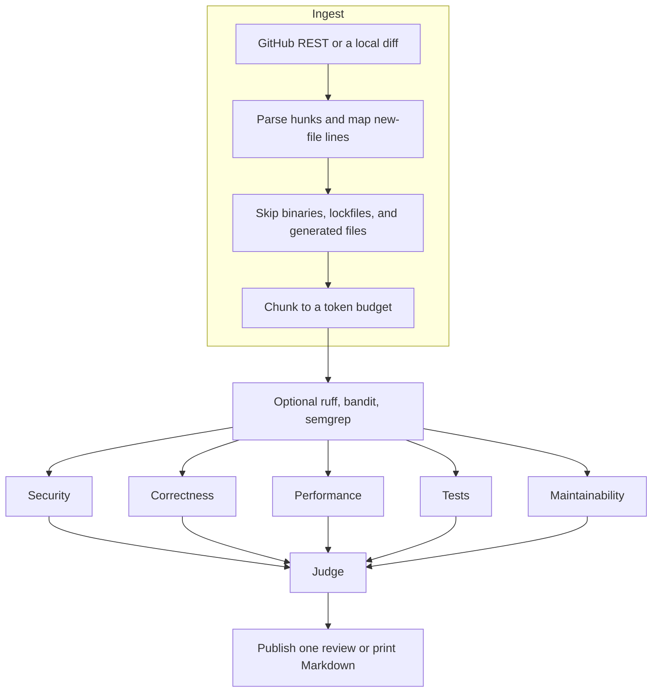

# PR Review Crew

PR Review Crew is a multi-agent pull request reviewer that runs on free tiers. Five specialists read a diff in parallel, a judge drops anything that does not match a real line in that diff, and a publisher posts one GitHub review. The default model is a deterministic mock, so tests, CI, and a local demo need no API key.

The same package is a CLI, a reusable GitHub Action, and an optional webhook server.

## Architecture



LangGraph runs the specialists in one superstep, so they execute concurrently. Each returns structured findings (`file`, `line`, `severity`, `category`, `confidence`, `explanation`, optional `suggested_fix`). The judge does not trust those line numbers. It keeps a finding only when the line is on the right side of a hunk, then dedupes, ranks by severity weight times confidence, and caps the comment count.

| Specialist | What it looks for |
| --- | --- |
| Security | Injection, secrets, missing authz, unsafe deserialization, shell commands |
| Correctness | Logic bugs, off-by-one, swallowed errors, None derefs, unlocked shared updates |
| Performance | N+1 queries, repeated allocation in a loop |
| Tests | Changed logic with no test file in the diff, plus a suggested case |
| Maintainability | Long lines, oversized parameter lists, new TODOs |

Providers sit behind one `complete()` interface:

| Provider | When it is used | Default model |
| --- | --- | --- |
| `mock` | Default. Offline heuristics. CI and demos. | `mock-heuristic-v1` |
| `groq` | `GROQ_API_KEY` set, or `provider: groq` | `openai/gpt-oss-120b` |
| `gemini` | `GEMINI_API_KEY` or `GOOGLE_API_KEY` | `gemini-2.5-flash` |
| `ollama` | A local daemon | `llama3.2` |
| `auto` | Groq if its key is set, else Gemini, else mock | the chosen provider's default |

`auto` is what the GitHub Action uses. A repo with no secrets still gets a review.

## Quickstart

```bash
python3.11 -m venv .venv
source .venv/bin/activate
pip install -e .

prcrew review examples/demo.diff
```

That prints Markdown and does not call GitHub. To review a live pull request and post it:

```bash
export GITHUB_TOKEN=...          # contents read, pull requests write
prcrew review owner/repo#123     # posts unless you pass --dry-run
```

Hosted models, still on their free tiers:

```bash
export GROQ_API_KEY=...
prcrew review examples/demo.diff --provider groq

export GEMINI_API_KEY=...
prcrew review examples/demo.diff --provider gemini

# local model, no key
prcrew review examples/demo.diff --provider ollama --model llama3.2
```

`prcrew review --help` lists `--severity`, `--max-comments`, `--no-cache`, `--no-static`, and `--format json`.

## GitHub Action

Checkout the pull request head, then call the action. `provider: auto` uses Groq when the `GROQ_API_KEY` secret exists and the mock otherwise.

```yaml
name: PR Review
on:
  pull_request:
    types: [opened, synchronize, reopened]
permissions:
  contents: read
  pull-requests: write
jobs:
  review:
    runs-on: ubuntu-latest
    steps:
      - uses: actions/checkout@v4
        with:
          ref: ${{ github.event.pull_request.head.sha }}
      - uses: deepanshuvarshney/pr-review-crew@main
        with:
          github-token: ${{ secrets.GITHUB_TOKEN }}
          provider: auto
          groq-api-key: ${{ secrets.GROQ_API_KEY }}
```

This repo's [`.github/workflows/pr-review.yml`](.github/workflows/pr-review.yml) dogfoods `uses: ./` the same way. Fork pull requests are skipped because `GITHUB_TOKEN` cannot comment on them.

`GITHUB_TOKEN` is not allowed to approve a pull request. If the verdict is approve and GitHub returns 422, the publisher retries the review as a comment and still writes **Verdict: approve** in the body.

## Webhook server

```bash
export GITHUB_TOKEN=...
export PRCREW_WEBHOOK_SECRET=...
prcrew serve --host 0.0.0.0 --port 8000
```

`POST /webhook` checks `X-Hub-Signature-256` with HMAC-SHA256. A missing secret rejects every delivery. `pull_request` events `opened`, `synchronize`, and `reopened` are queued; other events return 200 and do nothing. `GET /health` is unauthenticated.

## Configuration

`.prcrew.yml` in the repo root. CLI flags override environment variables, which override the file.

```yaml
provider: mock
severity_threshold: low
confidence_threshold: 0.45
max_comments: 12
max_diff_tokens: 8000
agents:
  security: true
  correctness: true
  performance: true
  tests: true
  maintainability: true
static_analysis: true
static_tools: [ruff, bandit, semgrep]
cache_enabled: true
cache_dir: .prcrew/cache
```

Lockfiles, binaries, and generated paths are always skipped. `ignore_paths` adds globs on top of that. A missing config file is fine.

Useful environment variables: `GITHUB_TOKEN`, `GROQ_API_KEY`, `GEMINI_API_KEY`, `GOOGLE_API_KEY`, `OLLAMA_HOST`, `PRCREW_PROVIDER`, `PRCREW_MODEL`, `PRCREW_SEVERITY`, `PRCREW_DISABLE_AGENTS`, `PRCREW_WEBHOOK_SECRET`, `PRCREW_LOG_FORMAT` (`json` or `text`).

## Sample review

`prcrew review examples/demo.diff` on the mock provider:

````markdown
## PR Review Crew

**Verdict:** request changes
**Provider:** mock (`mock-heuristic-v1`)

Review of local diff. Reviewed 2 file(s) (0 skipped). Publishing 3 comment(s): performance 1, security 1, tests 1. Highest signal: high security in app/db.py:2 (Interpolated SQL). Verdict: request changes.

| Severity | Category | Location | Confidence | Finding |
| --- | --- | --- | --- | --- |
| high | security | `app/db.py:2` | 0.91 | Interpolated SQL |
| medium | performance | `app/orders.py:4` | 0.78 | Query inside a loop |
| medium | tests | `app/db.py:1` | 0.64 | Missing test coverage |

### app/db.py:2

**[high] Interpolated SQL**

This builds a SQL statement with string interpolation. A quote in the value can change the query. Pass the value as a bound parameter instead.

```suggestion
    cur.execute("SELECT * FROM users WHERE name = %s", (name,))
```
````

A single-line `suggested_fix` is posted as a GitHub suggestion. A fix that is not a safe one-line replacement is left in the explanation instead of a suggestion block. Secrets are not repeated in the comment body.

## Evaluation

`evals/dataset/` holds 15 labelled diffs. Matching is exact on file, category, and line. `prcrew eval` runs the full pipeline, including the judge. CI runs it with the mock provider and fails if macro precision drops below 0.80 or macro recall below 0.75.

`subtle_boundary` is a real miss on purpose: the end of a window is inclusive when the rest of the program treats it as exclusive, and the heuristics do not have a rule for that. `safe_query` and `docs_only` are clean diffs and must produce no findings.

Current mock results (`prcrew eval`):

| Category | TP | FP | FN | Precision | Recall |
| --- | ---: | ---: | ---: | ---: | ---: |
| security | 5 | 0 | 0 | 1.00 | 1.00 |
| correctness | 4 | 0 | 1 | 1.00 | 0.80 |
| performance | 2 | 0 | 0 | 1.00 | 1.00 |
| tests | 12 | 0 | 0 | 1.00 | 1.00 |
| maintainability | 3 | 0 | 0 | 1.00 | 1.00 |
| micro | 26 | 0 | 1 | 1.00 | 0.96 |
| macro |  |  |  | 1.00 | 0.96 |

Pass `--provider groq` or `--provider gemini` to score a hosted model on the same labels. Those runs are not the CI gate. The mock numbers above measure the pipeline and the heuristics, not a frontier model.

## Design decisions

**The judge is code.** Models invent line numbers. Every finding is checked against the hunk map before it can be published. Dedupe, the severity floor, the confidence floor, the rank (`severity weight × confidence`), the cap, and the verdict are deterministic. A hosted model may draft the summary prose. If that call fails, the template is used and the verdict does not change.

**One failed specialist is not a failed review.** Each agent has its own timeout. An exception or a timeout is recorded and the other agents still publish. If every agent fails, the verdict is `comment` rather than `approve`, so a silent security outage cannot rubber-stamp the pull request.

**The mock is a reviewer, not an empty stub.** It implements the same JSON contract as Groq, Gemini, and Ollama. CI, the dogfood Action, and `examples/demo.diff` all exercise parse, judge, and publish. The heuristics are narrow on purpose. A parameterized query is not flagged. A secret in a comment is not flagged. An admin route with `login_required` is not flagged.

**Publishing is idempotent per head SHA.** GitHub will not edit inline review comments in place. The publisher keeps one issue comment (`<!-- prcrew:summary -->`) and updates it on every run. It posts inline comments once per head SHA (`<!-- prcrew:sha:... -->`). A later run on the same commit updates the summary and does not add a second review. A new commit gets a new review, because the lines moved. Re-running on the same SHA does not spam the conversation.

**Static analysis is evidence.** If `ruff`, `bandit`, or `semgrep` are installed, they run on changed files that exist on disk. Hits outside the diff are dropped. The rest is handed to the matching specialist, which may cite them. The tools never post comments on their own, so a ruff finding and a model finding on the same line collapse to one comment.

**Cost is counted even when the bill is zero.** Every call records input and output tokens. Free-tier providers bill `$0`. An illustrative list price is stored next to that so a future paid model can be compared. Groq, Gemini, and GitHub requests retry on 429 and 5xx, honor `Retry-After`, and back off exponentially. API keys are sent as headers and are not written to logs.

**Reviews are cached by head SHA plus a config fingerprint.** Changing the threshold or the provider invalidates the cache. A cache hit still runs the idempotent publisher, so a failed post can be retried without another model call.

**The Action is composite, not a container.** It installs this package and runs the CLI. There is no image to build or host, and the Action, the CLI, and the webhook cannot drift apart.

## Production behavior

- Retries with backoff for LLM and GitHub calls, including primary and secondary GitHub rate limits.
- Per-agent and per-tool timeouts. HTTP clients use the same budget so a stuck socket ends.
- Structured logs (`event=ingest_done`, `agent_failed`, `judge_done`, `publish_posted`). JSON when stderr is not a terminal or `PRCREW_LOG_FORMAT=json`.
- Large diffs are split under `max_diff_tokens` (about 4 characters per token). Each piece repeats the file header so line numbers stay valid.
- `enabled: false` in the config returns without calling a model or posting.

Verdicts: any kept high or critical finding requests changes. Any medium finding comments. Only low findings, or none, approve. Low findings are still posted when they clear the threshold, so an approval can carry nits.

## Development

```bash
pip install -e ".[dev]"
ruff check src tests
ruff format --check src tests
mypy src
pytest
prcrew eval --strict
```

Python 3.11 and 3.12. Tests use the mock provider, recorded HTTP transports, and no network. CI is [`.github/workflows/ci.yml`](.github/workflows/ci.yml).

See [CONTRIBUTING.md](CONTRIBUTING.md) for adding an eval case or a provider.

## Roadmap

- Multi-line GitHub suggestions, with the comment spanning the replaced range.
- A Check Run in addition to the review, so annotations show up in the files tab even when the review event is a comment.
- Confidence calibration per provider, using the labelled dataset as the holdout.
- Optional human accept/reject labels so prompt changes can be hill-climbed without loosening the judge.
- SARIF upload for the static-analysis evidence.
- GitLab and Bitbucket publishers behind the same review object.
- Prompt caching across chunks on providers that support it.

## License

[MIT](LICENSE)
